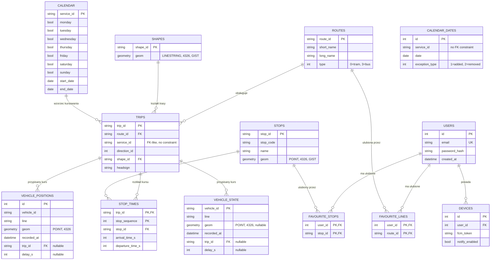

# ERD – model danych WroTransit

Stan po Sprincie 2: pełny schemat GTFS (odtwarzany przy każdym imporcie), tabele na bieżące
pozycje pojazdów (puste do Sprintu 3) i tabele użytkowników (puste do Sprintu 5).

## Uwagi

- `trips.service_id` i `calendar_dates.service_id` nie mają ograniczenia FK — `calendar_dates.txt`
  może zawierać `service_id`, którego nie ma w `calendar.txt` (serwis zdefiniowany tylko przez
  wyjątki), więc sztywny FK blokowałby poprawny import części realnych feedów GTFS.
- `VEHICLE_POSITIONS`/`VEHICLE_STATE`/`USERS`/`FAVOURITE_*`/`DEVICES` mają gotowy schemat, ale są
  puste do czasu implementacji pollingu pojazdów (Sprint 3) i autoryzacji (Sprint 5).
- Indeksy GIST: `stops.geom`, `shapes.geom` (zapytania przestrzenne pod przyszłe
  `/stops/nearby`).
